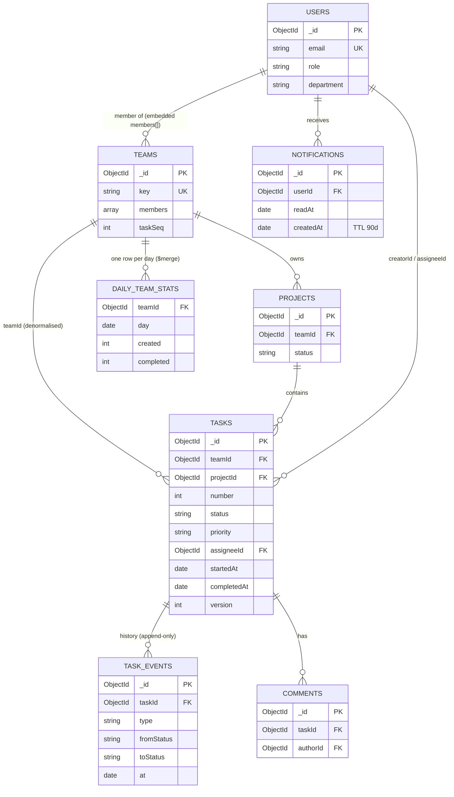

# Database design

This document explains how TaskFlow stores data and why. It is written to be walked through in an interview: every collection, field and index below exists because of a specific query or guarantee.

The design has two layers:

1. **Operational (MongoDB)** — what the app reads and writes: current task state plus an append-only event log.
2. **Analytical (star schema)** — the same data reshaped into dimension and fact tables for SQL and BI tools, exported by `server/scripts/export-star-schema.js`.

## 1. Entity relationship diagram

## 2. Collections

### `users`
| Field | Type | Notes |
|---|---|---|
| `email` | string, unique | Lower-cased on write, so the unique index is effectively case-insensitive |
| `passwordHash` | string | bcrypt, `select: false` so it never leaves the server by accident |
| `role` | `admin` \| `manager` \| `member` | Global role. Team-level roles live on the team |
| `title`, `department` | string | Exist for analytics (they become columns in `dim_user`) |

### `teams`
Members are **embedded** as `members: [{ userId, role, joinedAt }]`.

- *Why embed?* Membership is read on every authorization check and a team has tens of members, not thousands, so the array is bounded (validator caps it at 200). One document read answers "can this user edit this board?"
- *Reverse lookup* ("which teams am I in?") uses a multikey index on `members.userId`.
- `taskSeq` is an atomic counter (`$inc`) that issues human-readable keys like `PLAT-142` without race conditions.

### `projects`
Belongs to a team. Unique `(teamId, name)` prevents duplicate project names within a team.

### `tasks` — current state
The board reads this collection. It holds only the **latest** state of each task.

| Field | Why it exists |
|---|---|
| `teamId` | Denormalised from the project. Every board query and RBAC check filters by team, so it avoids a `$lookup` on the hottest path |
| `number` | Per-team sequence, unique with `teamId` |
| `status`, `priority` | Enums shared with validators and analytics via `models/constants.js` |
| `startedAt`, `completedAt`, `reopenCount` | **Denormalised lifecycle milestones**, derived from the event log by the service layer. Cycle time and throughput become single-collection index scans instead of event-log reconstructions |
| `commentCount` | Counter so cards never count comments |
| `deletedAt` | Soft delete. A hard delete would orphan history and silently change past metrics |
| `version` | Optimistic concurrency. Updates are `updateOne({ _id, version })`; if two people drag the same card, the second gets a 409 instead of overwriting |

History is deliberately **not** embedded in the task. An embedded `history[]` grows without bound, is re-sent on every board read, and makes "time in each status" queries awkward.

### `task_events` — the event log
One immutable document per change. This is the analytical source of truth.

| Field | Notes |
|---|---|
| `taskId`, `teamId`, `projectId`, `actorId` | `teamId`/`projectId` are copied onto each event so analytics can filter without joining back to tasks |
| `type` | `created`, `status_changed`, `assigned`, `priority_changed`, `due_date_changed`, `estimate_changed`, `commented`, `deleted`, `restored` |
| `fromStatus` / `toStatus`, `fromAssigneeId` / `toAssigneeId`, `fromValue` / `toValue` | **Typed before/after columns** rather than a free-form `Mixed` payload, so they can be indexed, validated and exported to CSV cleanly |
| `priority`, `assigneeId` | Snapshot of the task *at the moment of the event*. This captures a slowly changing dimension for free: "how long did urgent tasks sit in review?" uses the priority they had then, not now |
| `at` | Event time |

Immutability is enforced in code (Mongoose middleware rejects updates and deletes on this model) and the write path always inserts the event in the **same transaction** as the task update, so the two can never disagree. Running on a replica set (Atlas, or the provided docker-compose) enables transactions; on a standalone server the code degrades to sequential writes.

### `comments`
Separate collection because comments per task are unbounded. Indexed by `(taskId, createdAt)` for the drawer.

### `notifications`
`(userId, readAt, createdAt)` serves both the unread badge and the inbox list. A **TTL index** on `createdAt` expires notifications after 90 days, so the collection does not grow forever.

### `daily_team_stats` — periodic snapshot
One row per team per local day (created, completed, reopened, status changes, active users). Built from `task_events` by an aggregation ending in `$merge` with `on: [teamId, day]`, so it is **idempotent**: re-running any window overwrites those days. A Render cron job refreshes the last 3 days nightly.

## 3. Indexes and the queries they serve

| Collection | Index | Query |
|---|---|---|
| tasks | `{ teamId: 1, number: 1 }` unique | Look up `PLAT-142` |
| tasks | `{ projectId: 1, status: 1, position: 1 }` | Board columns. Equality, equality, then sort (ESR rule) |
| tasks | `{ assigneeId: 1, status: 1, dueDate: 1 }` | "My work", per-person workload, overdue per person |
| tasks | `{ teamId: 1, status: 1, dueDate: 1 }` | Team board filters and overdue counts |
| tasks | `{ teamId: 1, completedAt: 1 }` partial (`completedAt` is a date) | Throughput and cycle time. Partial: open tasks are not indexed at all |
| tasks | `{ teamId: 1, createdAt: 1 }` | Arrival rate |
| tasks | text on `title` (weight 5), `description` | Search box |
| task_events | `{ taskId: 1, at: 1 }` | Task timeline; also the partition + sort for window functions |
| task_events | `{ teamId: 1, type: 1, at: 1 }` | Team analytics over a date range |
| task_events | `{ type: 1, toStatus: 1, at: 1 }` | Transition analysis (e.g. everything that entered `blocked`) |
| task_events | `{ actorId: 1, at: -1 }` | Per-user activity feed |
| teams | `{ 'members.userId': 1 }` multikey | Teams I belong to |
| notifications | `{ userId: 1, readAt: 1, createdAt: -1 }` | Unread count + inbox |
| notifications | `{ createdAt: 1 }` TTL 90 days | Automatic expiry |

`GET /api/analytics/explain` (admin only) returns `explain('executionStats')` for the throughput pipeline so you can show an `IXSCAN` rather than a `COLLSCAN` live.

## 4. Data quality — three layers

1. **API layer:** zod schemas validate every request body and query string.
2. **ODM layer:** Mongoose schemas enforce types, enums, lengths and array limits.
3. **Database layer:** `$jsonSchema` validators (`npm run validators`) on `tasks` and `task_events`, including a cross-field rule: a task in `done` must have `completedAt`, and any other status must not. This catches bad writes from scripts or the shell that bypass the app.

`analytics/sql/queries.sql` ends with a set of reconciliation checks (task state vs. last event, impossible timestamps, orphans, duplicate keys). All return 0 on the seeded data.

## 5. Analytics in MongoDB

All pipelines live in `server/src/analytics/pipelines.js` as pure functions, unit-tested in `server/tests/pipelines.test.js` against plain-JS recomputations.

| Pipeline | Technique worth pointing at |
|---|---|
| `summary` | `$facet` computes KPI tiles in a single pass |
| `throughputByWeek` | `$dateTrunc` with a time zone and Monday week start — weeks are local, not UTC |
| `cycleTimeByPriority` | Percentiles via sort, `$push`, and nearest-rank `$arrayElemAt` (works on MongoDB 5+; on 7+ `$percentile` is an alternative) |
| `timeInStatus` | `$setWindowFields` with `$shift` — the MongoDB equivalent of SQL `LEAD(at) OVER (PARTITION BY task_id ORDER BY at)` |
| `wipOverTime` | Each event contributes +1/−1 to open work; a running `$sum` window over all history gives true WIP per day |
| `reworkByTeam` | Conditional counts on transitions: review bounce-backs, reopens, blocks |
| `workloadByAssignee` | `$lookup` to users and a priority-weighted load score |
| `dailyTeamSnapshot` | `$merge` into a snapshot table, idempotent |

## 6. Star schema for SQL / BI

`npm run export` writes CSVs to `analytics/data/`; `analytics/run_analysis.py` loads them into DuckDB with primary and foreign keys enforced (`analytics/sql/00_schema.sql`).

| Table | Grain | Built from |
|---|---|---|
| `dim_date` | one row per local calendar day | generated calendar |
| `dim_user` | one row per user | `users` + primary team membership |
| `dim_team`, `dim_project` | one row per team / project | `teams`, `projects` |
| `fact_task` | one row per task (accumulating snapshot) | `tasks` + review/blocked counts from events |
| `fact_task_event` | one row per change (transaction fact) | `task_events` |
| `fact_status_interval` | one row per stint in a status | `task_events` with `LEAD()` logic |
| `bridge_task_label` | one row per task-label pair | `tasks.labels` (many-to-many) |

## 7. Metric definitions

| Metric | Definition |
|---|---|
| Wait time | `startedAt − createdAt` (time before anyone works on it) |
| Cycle time | `completedAt − startedAt` |
| Lead time | `completedAt − createdAt` (what the requester experiences) |
| Throughput | Tasks entering `done` per week |
| WIP | Tasks not in `done` at the end of a day |
| Review bounce rate | Transitions `in_review → in_progress` ÷ all transitions out of `in_review` |
| First-pass review rate | `1 − review bounce rate` |
| Reopen rate | Transitions out of `done` ÷ transitions into `done` |
| On-time rate | Of completed tasks with a due date, share with `completedAt ≤ dueDate` |
| Weighted load | Sum of priority weights of open tasks (urgent 5, high 3, medium 2, low 1) |

## 8. Trade-offs to discuss

- **Denormalisation vs. consistency.** `teamId` on tasks and events, and lifecycle timestamps on tasks, duplicate data. They are written only by `taskService` inside a transaction, so there is one write path to keep correct.
- **Event log size.** `task_events` grows roughly 7× faster than tasks. Mitigations: compound indexes that cover range scans, the daily snapshot table for dashboards, and archiving events older than N months to cold storage (Atlas Online Archive) without touching current state.
- **Why MongoDB at all for analytics?** The operational app benefits from flexible documents and embedded membership; analysts get a relational star schema via the export. Each side gets the shape that suits it.
- **What I would add next:** change streams to push events into a warehouse continuously instead of batch export; a `task_snapshots` table capturing daily state for point-in-time backlog analysis.
